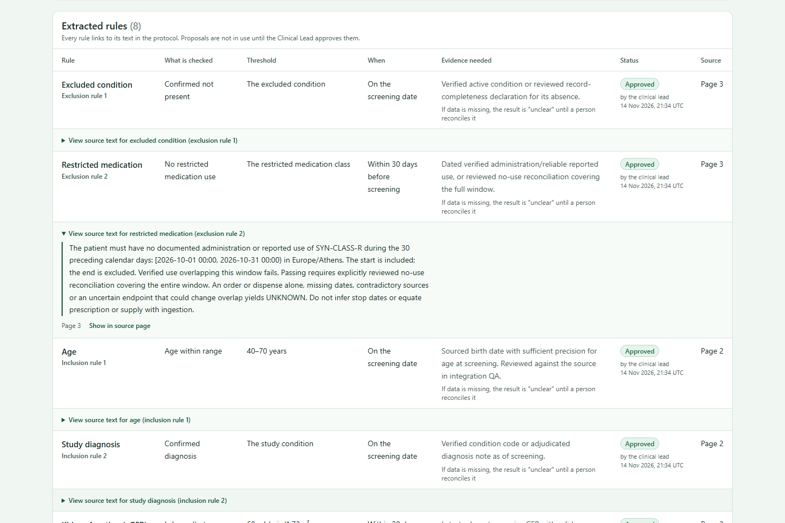
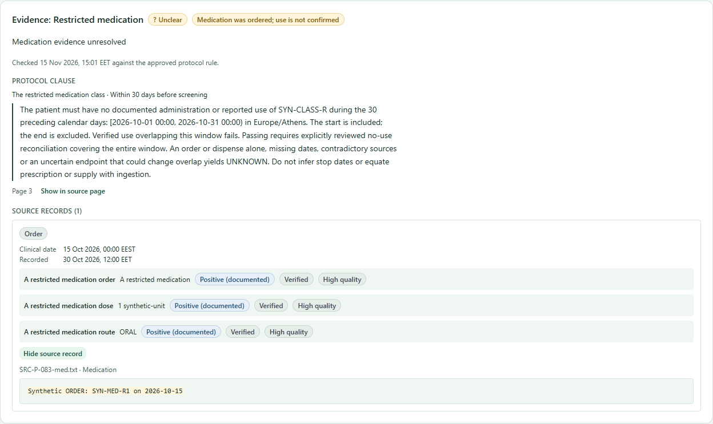
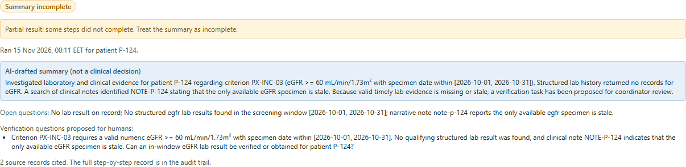
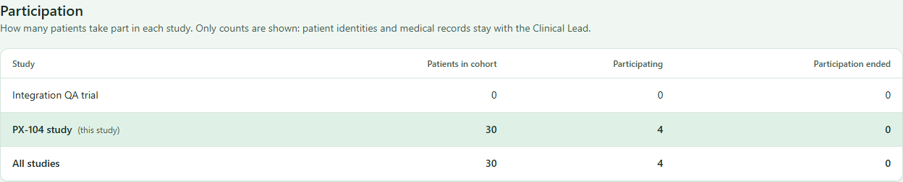

# ProtocolPulse

### Clinical trial monitoring that follows the evidence.

Turn protocol requirements into reviewed rules. Screen patients, follow new medical events and bring source-backed cases to a Clinical Lead in one connected workspace.

**AI investigates. Approved rules drive evaluation. People make clinical decisions.**

[Run locally](docs/GETTING_STARTED.md) · [Explore the workflow](docs/WORKFLOW.md) · [Inspect the evidence](docs/verification/README.md)


*One cohort, three clear outcomes: potential match, needs review or protocol conflict. Every result opens into its evidence.*

## From protocol to action

### Review the rule. Read the source.

Extracted criteria retain their source quotes and page references. The Clinical Lead reviews the rules and coverage before they can drive screening.



### Keep uncertainty visible

A medication order does not establish use. The patient workspace puts the approved clause, clinical dates and source record together so the reviewer can see what remains unresolved.



### See why the agent took its next step

For P-124, a saved Gemini investigation inspected laboratory history and notes, found no qualifying current result and requested human verification.



Different evidence leads to different investigation paths:

| Situation | Observed agent response |
|---|---|
| Missing or stale lab | Inspect labs and notes; request a qualifying result. |
| Medication order without confirmed use | Check terminology and medication evidence; request verification. |
| Irrelevant event | Stop after relevance classification. |

[Recorded Gemini executions](docs/verification/evidence/live-investigations.json) show the actual tool choices. The investigation pictured above is a [saved provider execution](docs/verification/evidence/showcase-investigation.json), displayed without running new inference.

<details>
<summary>Inspect the tool sequence behind the lab investigation</summary>

```text
get_lab_history
  → retrieve_patient_evidence
  → search_notes
  → get_evidence_link
  → request_verification_task
```

The result remains **PARTIAL** because evidence is unresolved. The backend owns rule results; the agent cannot approve rules, enroll patients or change treatment.

</details>

### Turn new evidence into accountable review

New records trigger targeted monitoring against approved rules. Cases bring together findings, source evidence, review history and a human decision. Historical screening results remain intact.


<details>
<summary>The Sponsor workspace: follow participation without patient-level records</summary>

Sponsor prepares the protocol and follows aggregate participation. Clinical Lead owns approval, screening, patient evidence and Safety review.



</details>

## Try the complete workflow

Follow the [setup guide](docs/GETTING_STARTED.md), then walk through [protocol → approval → screening → participation → monitoring → review](docs/WORKFLOW.md). Requires **Python 3.12** and **Node.js 24**. Gemini is optional; deterministic screening and monitoring continue with AI disabled.

Built with **Next.js, React, FastAPI, SQLite and Gemini**. [Architecture](docs/SYSTEM_ARCHITECTURE.md) · [AI implementation](docs/AI_IMPLEMENTATION.md) · [Verification](docs/verification/README.md)

*Current scope: fictional PX-104, eight supported rules and 30 synthetic patient profiles. Interface captures use the real API on an isolated dataset; saved AI results are identified above. The role dropdown simulates permissions. Production identity, unrestricted protocol ingestion and clinical validation remain outside this release.*
