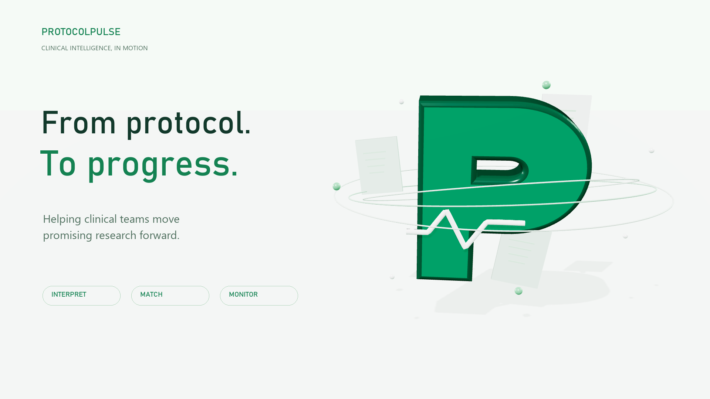
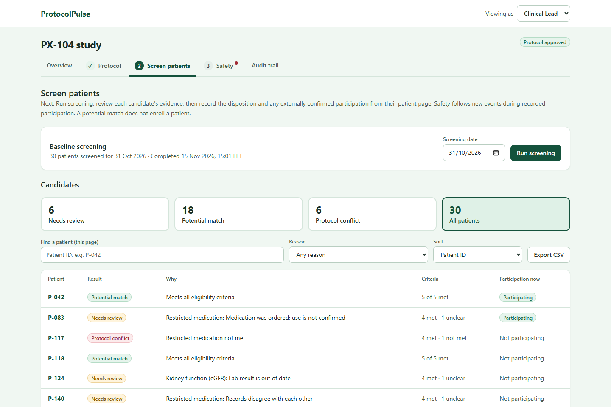
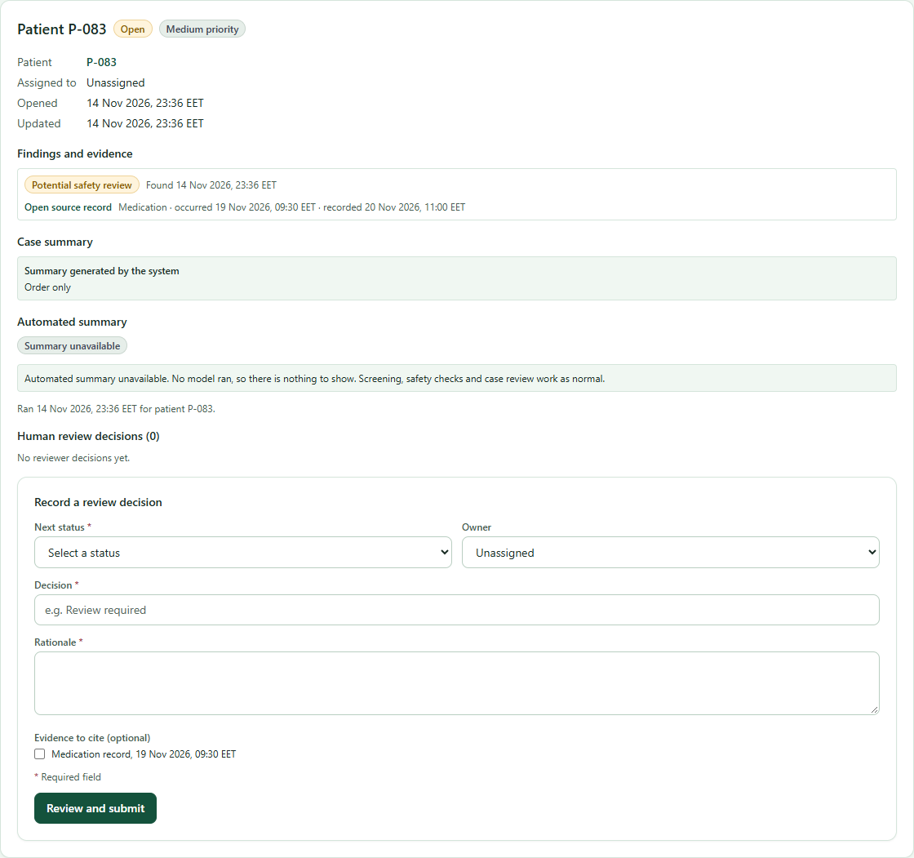

# ProtocolPulse

### From protocol. To progress.

**AI-assisted clinical trial screening and monitoring, with evidence at every step.**

[Watch the 60-second demo](https://youtu.be/Fgcc1lhQZOM) · [Run locally](docs/GETTING_STARTED.md) · [Explore the workflow](docs/WORKFLOW.md)

## Promising medicines need rigorous trials. Patients are waiting.

Between a trial protocol and a clinical decision sits a demanding chain of work: interpret eligibility criteria, check patient records, resolve missing evidence and review changes as they happen.

**ProtocolPulse connects that work in one evidence-led workspace.** AI turns supported protocol clauses into source-linked rule proposals and investigates patient evidence. Approved rules drive screening and monitoring. Clinical teams keep control of approvals and decisions.

The ambition is simple: spend less time reconstructing the evidence and more time moving research forward. More efficient trials could help new medicines reach the patients who need them sooner.

> **AI assists. Clinical teams decide. Keep the trial moving.**

## One protocol. One connected journey.

The [demo](demo/final_demo.mp4) follows the real application from a protocol PDF to a documented human review, using actual backend results and Gemini execution.

| Step | What ProtocolPulse does | Why it matters |
|---|---|---|
| **1. Interpret** | Extracts inclusion and exclusion criteria into proposed rules, linked to source quotes and pages. | Reviewers can trace a rule back to the protocol that defines it. |
| **2. Approve** | Gives the Clinical Lead the rules, source clauses and coverage to review before activation. | Human approval determines what drives evaluation. |
| **3. Match** | Screens the cohort for potential matches, protocol conflicts and evidence that needs review. | Teams can see where to focus and what information is still missing. |
| **4. Follow** | Records externally confirmed participation and evaluates new clinical records against approved monitoring rules. | Review continues as patient evidence changes. |
| **5. Investigate** | Brings findings into a review case; AI retrieves evidence and drafts a cited summary. | Reviewers get the context needed to assess the finding. |
| **6. Decide** | Lets the Clinical Lead record a rationale, cite evidence and acknowledge the case. | The next step has a named reviewer and a review history. |

## The difference is in the evidence

### A match is only useful when you can explain it

Screening brings patient outcomes and their reasons into view. Open a patient to inspect the approved criterion, clinical dates and underlying source records.

### Missing evidence stays visible

In the film, **P-083 has a medication order without confirmed use**. ProtocolPulse keeps that uncertainty visible for review. An order alone does not establish that a patient took the medication.

That distinction is central to the product: help teams identify what they know, what conflicts with the protocol and what still needs verification.

### Screening is the beginning of the story

The demo then follows **P-042**: a Clinical Lead confirms external participation, a new medication record triggers a protocol conflict, and AI investigates. The reviewer examines the evidence and records a cited acknowledgement.

Historical screening results remain intact while new evidence creates a new reason to review.

## Built to give clinical teams time back

| For | The value |
|---|---|
| **Clinical Leads** | A connected path from protocol clauses to patient evidence and documented review, designed to reduce repetitive checking. |
| **Trial sponsors** | Protocol preparation and aggregate participation visibility, while patient-level review stays in the Clinical Lead workspace. |
| **Research teams** | Traceable rules, explicit uncertainty and review history that make it easier to understand why a case needs attention. |
| **Patients, ultimately** | The potential benefit of more efficient trial operations: helping promising research progress toward the people who need it. |

These are the intended benefits. The prototype demonstrates the workflow; it does not establish measured time savings or earlier medicine availability.

## AI with a clear role

**Gemini proposes and investigates. The backend evaluates approved rules. People approve and decide.**

- **Traceable proposals:** extracted criteria retain source quotes and page references for human review.
- **Evidence-driven investigation:** the agent can inspect labs, medications and notes, retrieve source references and request verification when evidence is incomplete.
- **Explicit uncertainty:** missing evidence and failed or partial investigations remain visible.
- **Human authority:** AI cannot approve rules, enroll patients, change treatment or determine the clinical disposition.
- **Independent monitoring:** deterministic screening and monitoring remain available with AI disabled. The offline extraction path uses a clearly labeled curated fixture.

Read the [AI implementation](docs/AI_IMPLEMENTATION.md) or inspect the [recorded executions and verification evidence](docs/verification/README.md).

## Try ProtocolPulse

Follow the **[local setup guide](docs/GETTING_STARTED.md)**, then walk through the **[complete demo workflow](docs/WORKFLOW.md)**.

Requires **Python 3.12** and **Node.js 24**. The standard setup includes the shared **30-patient synthetic cohort**. For an existing installation, preserve its database, apply migrations and run `python -m tools.add_demo_patients` in the project's working environment before starting or reusing the servers. Start a new screening to include newly imported patients.

| Layer | Technology |
|---|---|
| Clinical workspace | Next.js and React |
| API and evaluation | FastAPI and Python |
| Persistence and background work | SQLite-backed storage and worker |
| Protocol interpretation and investigation | Gemini through a scoped tool gateway |

[System architecture](docs/SYSTEM_ARCHITECTURE.md) · [Workflow guide](docs/WORKFLOW.md) · [Verification](docs/verification/README.md) · [Demo production and provenance](demo/v2/README.md)

### Current scope

This is a prototype built around the fictional **PX-104** protocol, **eight supported rules** and **30 synthetic patient profiles**. The role selector simulates identities. Production identity, unrestricted protocol ingestion and clinical validation remain outside this release. Monitoring flags cases for review; it does not diagnose patients or predict drug interactions.

---

**ProtocolPulse · Keep the trial moving.**

Bring tomorrow's medicines closer, one evidence-backed review at a time.

